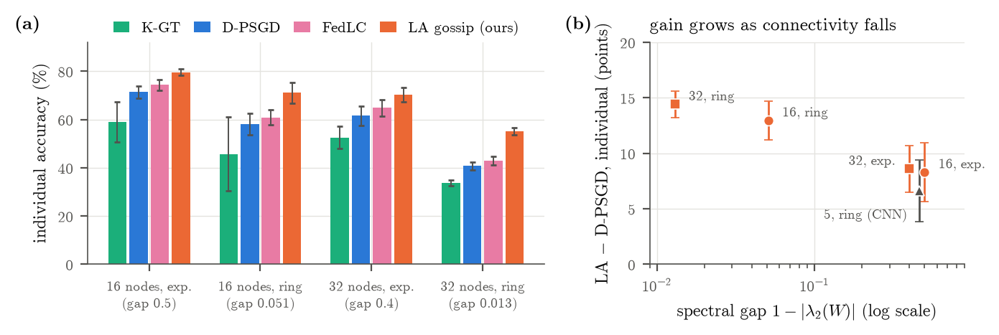

# Logit-Adjusted Gossip

Code and results for the paper:

> A. K. Mathur, K. Periyasami. **Logit-Adjusted Gossip: Removing Label-Skew Heterogeneity in Decentralized Learning at No Communication Cost.** Submitted to *Discover Computing* (Springer Nature), 2026.

Each node of a decentralized (gossip) network trains with its logits shifted by the logarithm of its own class frequencies, predicts with the unshifted logits, and communicates exactly as D-PSGD does. The change is one line in the local loss (`src/lagossip.py`, function `_offset`).

## Main results

Five-node ring, CNN, Dirichlet label skew α = 0.1, 5 seeds (mean ± s.d., accuracy in %):

| Method | Comm. | CIFAR-10 individual | CIFAR-100 individual |
|---|---|---|---|
| D-PSGD | 1× | 71.20 ± 4.67 | 51.05 ± 0.92 |
| K-GT | 2× | 69.88 ± 5.27 | 52.00 ± 0.82 |
| QGM (adapted) | 1× | 71.06 ± 3.91 | 50.57 ± 0.89 |
| FedLC (gossip) | 1× | 73.08 ± 4.27 | 51.74 ± 0.66 |
| FedRS (gossip) | 1× | 72.63 ± 3.88 | 50.03 ± 1.10 |
| GUT | 1× | 72.37 ± 4.71 | 51.96 ± 0.78 |
| **Logit-adjusted gossip** | 1× | **78.28 ± 2.80** | **54.26 ± 0.67** |

ResNet-18 on CIFAR-10, gain in individual accuracy over D-PSGD (5 seeds):

| Graph | D-PSGD | Logit-adjusted gossip | Gain |
|---|---|---|---|
| 16 nodes, ring | 58.08 | 71.04 | +12.96 |
| 16 nodes, exponential | 71.33 | 79.63 | +8.30 |
| 32 nodes, ring | 40.72 | 55.14 | +14.42 |
| 32 nodes, exponential | 61.57 | 70.16 | +8.60 |

<p align="center"></p>

## Code

```
src/lagossip.py     method, baselines (K-GT, QGM, GUT, FedLC, FedRS), data partitions, graphs, training loop
analysis/           scripts that compute the reported statistics from results/
results/            per-seed results and paired tests
plotting/           figure scripts
figures/            result figures (PDF and PNG)
theory/             numerical check of Proposition 1
tests/              smoke test
```

## Usage

```bash
pip install -r requirements.txt
python tests/smoke_test.py                 # CPU check of the whole pipeline
bash reproduce.sh                          # recompute the statistics and figures from results/
cd src && python lagossip.py --tiers 8 --out ../runs   # run an experiment group on a GPU
```

## Licence and citation

MIT licence. See `CITATION.cff` for how to cite.
